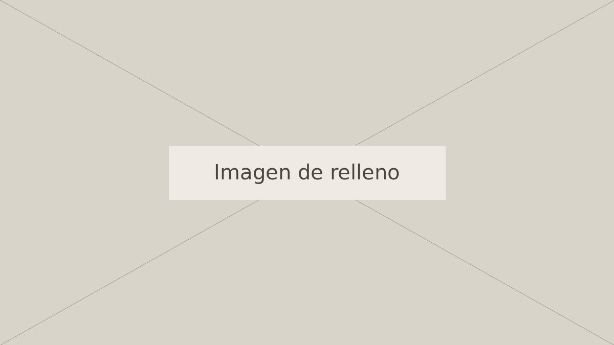

Lorem ipsum dolor sit amet, consectetur adipiscing elit[^1]. Sed do eiusmod tempor incididunt ut labore et dolore magna aliqua. Ut enim ad minim veniam, quis nostrud exercitation ullamco laboris nisi ut aliquip ex ea commodo consequat. Duis aute irure dolor in reprehenderit in voluptate velit esse cillum dolore eu fugiat nulla pariatur.

Excepteur sint occaecat cupidatat non proident, sunt in culpa qui officia deserunt mollit anim id est laborum. Curabitur pretium tincidunt lacus, nulla gravida orci a odio. Nullam varius, turpis et commodo pharetra, est eros bibendum elit, nec luctus magna felis sollicitudin mauris.

## Primera sección de relleno

Integer in mauris eu nibh euismod gravida. Duis ac tellus et risus vulputate vehicula. Donec lobortis risus a elit. Etiam tempor. Ut ullamcorper, ligula eu tempor congue, eros est euismod turpis, id tincidunt sapien risus a quam[^2]. Maecenas fermentum consequat mi. Donec fermentum. Pellentesque malesuada nulla a mi.

Duis sapien sem, aliquet nec, commodo eget, consequat quis, neque. Aliquam faucibus, elit ut dictum aliquet, felis nisl adipiscing sapien, sed malesuada diam lacus eget erat. Cras mollis scelerisque nunc. Nullam arcu. Aliquam consequat.

### Un apartado dentro de la primera sección

Curabitur blandit tempus ardua ridiculus sed magna. Phasellus laoreet lorem vel dolor tempus vehicula. Quisque ut dolor gravida, placerat libero vel, euismod nulla. Cras justo odio, dapibus ac facilisis in, egestas eget quam.

> [!destacada]
> Una frase de relleno que se repite del texto para destacarla.

Morbi in sem quis dui placerat ornare. Pellentesque odio nisi, euismod in, pharetra a, ultricies in, diam. Sed arcu. Cras consequat. Praesent dapibus, neque id cursus faucibus, tortor neque egestas augue, eu vulputate magna eros eu erat.

## Segunda sección de relleno

Aliquam erat volutpat. Nam dui mi, tincidunt quis, accumsan porttitor, facilisis luctus, metus. Phasellus ultrices nulla quis nibh. Quisque a lectus. Donec consectetuer ligula vulputate sem tristique cursus. Nam nulla quam, gravida non, commodo a, sodales sit amet, nisi.

> Una cita textual de relleno, con sus comillas angulares escritas a mano: «lorem ipsum dolor sit amet».

Pellentesque fermentum dolor. Aliquam quam lectus, facilisis auctor, ultrices ut, elementum vulputate, nunc. Sed adipiscing ornare risus. Morbi est est, blandit sit amet, sagittis vel, euismod vel, velit[^3]. Pellentesque egestas sem. Suspendisse commodo ullamcorper magna.

- Elemento de lista de relleno con una cifra escrita por el autor: 37 152 y 75.31%.
- Otro elemento de lista de relleno.

## Tercera sección de relleno

Nulla facilisi. Aenean nec eros. Vestibulum ante ipsum primis in faucibus orci luctus et ultrices posuere cubilia curae; suspendisse sollicitudin velit sed leo. Ut pharetra augue nec augue. Nam elit agna, endrerit sit amet, tincidunt ac, viverra sed, nulla.

Donec porta diam eu massa. Quisque diam lorem, interdum vitae, dapibus ac, scelerisque vitae, pede. Donec eget tellus non erat lacinia fermentum. Donec in velit vel ipsum auctor pulvinar. Vestibulum iaculis lacinia est. Proin dictum elementum velit. Fusce euismod consequat ante.

[^1]: Primera nota de relleno. Sirve para probar la ida desde la llamada y la vuelta con la flecha.
[^2]: Segunda nota de relleno, con un enlace de ejemplo: <https://example.org>.
[^3]: Tercera nota de relleno.
